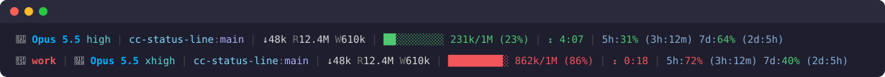

<div align="center">

# cc-status-line

**A status line for [Claude Code](https://docs.claude.com/en/docs/claude-code) that shows what the session costs and how long it has left.**

Model and effort · project and branch · token totals · session cost · context fill · prompt-cache countdown · rate-limit pace




</div>

---

## What you see

| Segment | Example | Meaning |
| --- | --- | --- |
| Profile | 🔴 `work` | Shown only for a config folder other than `~/.claude`, so you always know which account you are in |
| Model | 🧠 `Opus 5.5 high` | Model display name and reasoning effort |
| Location | `cc-status-line:main` | Project folder and current git branch |
| Tokens | `↓48k R12.4M W610k` | Session totals: output tokens, cache reads, cache writes |
| Cost | `$3.4612` | Session cost in USD as estimated by Claude Code from list prices (grey); hidden on subscription logins |
| Context | `██░░░░░░░░ 231k/1M (23%)` | Context window fill. Green, then yellow from 50%, red from 80% |
| Cache | `⧗ 4:07` | Time until the prompt cache expires. Yellow under 2 minutes, red under 30 seconds |
| Rate limits | `5h:31% (3h:12m) 7d:64% (2d:5h)` | Usage of the 5-hour and 7-day limits, and time to reset |

The rate-limit percentages are colored by **pace**: green while usage is at or below the share of the window that has passed, red when you are burning faster than that. `72%` used with 3 of 5 hours still left is red; `40%` of the week used on day five is green.

Segments with no data are left out. The line refreshes every 5 seconds.

## Install

Requirements: [uv](https://docs.astral.sh/uv/), `git`, and `jq` (used by the `/clear` hook).

```sh
git clone https://github.com/alex-peresunko/cc-status-line.git
cd cc-status-line
make install
```

Restart Claude Code. `make install` targets `$CLAUDE_CONFIG_DIR`, or `~/.claude` when that is unset. It:

- links `<config folder>/statusline.py` to the repository script,
- copies the default `statusline.toml` there unless one exists,
- sets `statusLine` in `settings.json` and adds a `UserPromptSubmit` hook that resets the token totals on `/clear`.

> [!IMPORTANT]
> Keep `statusline.py` in the config folder a **symlink**. The script loads the `claude_status/` package from next to the file it resolves to, so a copy fails to import it.

### Several Claude Code profiles

For a config folder other than `~/.claude`, pass a short profile name (1–12 letters, digits, `-` or `_`). It is shown with a 🔴 at the start of the line.

```sh
make install DIR=~/.claude-work NAME=work
```

### Uninstall

```sh
make uninstall                      # or: make uninstall DIR=~/.claude-work
```

This removes the link, the `statusLine` setting and the hook. Your `statusline.toml` is kept.

## Configure

Settings live in `statusline.toml` in the config folder. The file is re-read on every refresh, so edits apply within seconds.

```toml
[display]
ctx_warn  = 50       # context % where the bar turns yellow
ctx_crit  = 80       # ... and red
bar_width = 10       # characters in the context bar

[cache]
ttl = 300            # seconds; used only when Claude Code sends no prompt_cache.expires_at

[features.auto_compact]
enabled = false
tokens  = 150000     # compact at or above this many context tokens
within  = 30         # ... when this many seconds or fewer of cache remain
keep_warm = 12       # below tokens, send a keep-alive ping instead, at most this many in a row; 0 = off
```

Environment variables override the file: `CLAUDE_STATUS_CTX_WARN`, `CLAUDE_STATUS_CTX_CRIT`, `CLAUDE_STATUS_BAR_WIDTH`, `CLAUDE_STATUS_CACHE_TTL`. Set `CLAUDE_STATUS_CONFIG` to read the config from another path.

If the file has an error (bad TOML, an unknown key, a value of the wrong type), the line falls back to the defaults with every feature off and shows a red `cfg error`. The details go to stderr.

## Features

Features are opt-in actions that run on each refresh, after the line is printed. They are all off by default.

### `auto_compact`

Compacting while the prompt cache is still warm is far cheaper than after it expires. When the context is at least `tokens` large and the cache has `within` seconds or fewer left, this feature types `/compact` into the session's terminal, at most once per cache window.

Below `tokens` it types a short keep-alive ping instead, which tells Claude to ignore it and reply "ok". Its turn refreshes the cache. Pings stop after `keep_warm` in a row (12 × 5 min ≈ 1 h); any prompt of your own starts a new count.

- Works in **tmux** and **iTerm2** (detected automatically); does nothing elsewhere.
- Waits while a tool call is in flight or background subagents are running, so it never answers a permission prompt by accident.
- In tmux it also waits while text is typed in the input box.

> [!WARNING]
> In iTerm2 without tmux, a half-typed prompt at that moment gets the command appended to it.

## Development

```sh
make test            # runs the pytest suite through uv
```

```
statusline.py                 entry point: reads Claude Code's JSON on stdin, prints the line
claude_status/config.py       statusline.toml and CLAUDE_STATUS_* loading
claude_status/features/       feature contract, registry and features
claude_status/terminal.py     tmux / iTerm2 detection and typing
config/statusline.default.toml  template copied by make install
scripts/patch-settings.py     edits settings.json on install / uninstall
```

To add a feature, create a module in `claude_status/features/` with a `Settings` dataclass (every field defaulted, `enabled` off) and a `Feature` subclass, register it in `REGISTRY` in `features/__init__.py`, and add a matching `[features.<name>]` table to `config/statusline.default.toml`. A test keeps the template equal to the code defaults.
